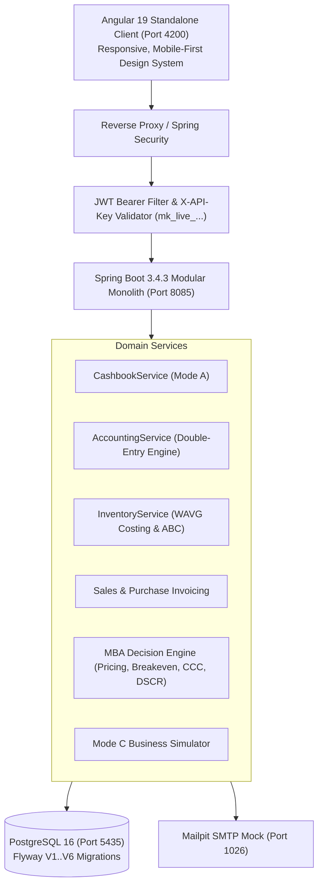

# MarginOS — Financial Operating System for Indian Businesses

[](https://spring.io/projects/spring-boot)
[](https://angular.dev)
[](https://openjdk.org)
[](https://www.postgresql.org)
[]()

> **MarginOS** is a financial operating system and business decision-support platform designed specifically for Indian small businesses, shopkeepers, kirana stores, retailers, distributors, and service enterprises.

---

## 🌟 Key Highlights

- **⚡ Mode A (Quick Start Shopkeeper Mode)**: Run your entire store with a 3-click daily sales & expense entry. Features automated counted cash variance reconciliation and 1-click WhatsApp daily closing digest.
- **📊 Mode B (Detailed ERP Mode)**: Full SKU product catalog, barcodes, Weighted-Average Costing (WAVG), GST sales invoicing, purchase bills, customer khata (udhaar), supplier dues, and Pareto ABC inventory analytics.
- **🔮 Mode C (Business Simulator)**: Test expansions, hiring, or rent hikes in a sandboxed what-if simulator before spending a single rupee.
- **⚖️ Strict Double-Entry Ledger**: Aligned with Indian Accounting Standards (AS-1, AS-2, Ind-AS). Enforces balanced journal entries ($\sum \text{Debits} = \sum \text{Credits}$) and immutable transaction logs with `BigDecimal` precision.
- **🎯 MBA Decision Engine**:
  - **Markup vs. Margin**: Demystifies the "Kirana Markup Trap" (proves why 25% markup is only 20% margin).
  - **Break-even Engine**: Calculates unit and revenue sales targets to cover monthly fixed overheads.
  - **Working Capital Cycle**: Monitors Cash Conversion Cycle (CCC = DIO + DSO - DPO).
  - **Loan & DSCR Check**: Tests loan affordability using banking Debt Service Coverage Ratios.
- **🔑 Developer Platform**: Versioned REST API with workspace-scoped API keys (`mk_live_...`), SHA-256 hash storage, and interactive Swagger documentation.

---

## 🚀 Quickstart & Demo Credentials

### 1. Start Infrastructure (Docker Compose)
```bash
docker compose up -d
```
- PostgreSQL: `localhost:5435`
- Mailpit Web UI: `http://localhost:8026`

### 2. Run Backend (Spring Boot 3.4.3)
```bash
cd marginos-backend
mvn clean package -DskipTests
java -jar target/marginos-backend-1.0.0.jar
```
- Server Port: `http://localhost:8085`
- Swagger UI: `http://localhost:8085/swagger-ui.html`
- Healthcheck: `http://localhost:8085/actuator/health`

### 3. Run Frontend (Angular 19 Standalone)
```bash
cd marginos-frontend
npm install
npm start
```
- Web Application: `http://localhost:4200`

### 4. Demo Login Credentials
A fully seeded demo workspace is pre-loaded:
- **Email:** `harshal@marginos.internal`
- **Password:** `MarginOS@123`
- **Business:** Gupta Kirana & General Store (New Delhi)
- *1-Click Auto-fill button available directly on the login page.*

---

## 📐 System Architecture



---

## 📁 Repository Structure

```
MarginOS/
├── marginos-backend/              # Spring Boot 3.4.3 Modular Monolith
│   ├── src/main/java/com/marginos/
│   │   ├── accounting/           # Double-entry ledger, Trial Balance, P&L, Balance Sheet
│   │   ├── ai/                   # Grounded financial explanations
│   │   ├── apikey/               # Cryptographic mk_live_... API key management
│   │   ├── auth/                 # Spring Security, JWT, Argon2id/BCrypt
│   │   ├── breakeven/            # Break-even units & revenue calculator
│   │   ├── budget/               # Monthly budget variance tracking
│   │   ├── business/             # Multi-tenant workspace management
│   │   ├── cashbook/             # Mode A Shopkeeper daily closing & variance
│   │   ├── csv/                  # CSV import/export with formula injection defense
│   │   ├── dashboard/            # Aggregated executive financial KPIs
│   │   ├── expense/              # Operating overheads tracking
│   │   ├── inventory/            # WAVG costing, ABC analysis, Dead stock, EOQ
│   │   ├── loan/                 # Loan EMI & DSCR affordability engine
│   │   ├── party/                # Customer khata & supplier payables aging
│   │   ├── pricing/              # Markup vs Margin calculator
│   │   ├── product/              # SKU catalog & barcodes
│   │   ├── purchase/             # Supplier bills & inventory intake
│   │   ├── sales/                # Invoices & 1-click counter POS
│   │   └── scenario/             # Mode C Business Simulator
│   └── src/main/resources/
│       └── db/migration/         # Flyway V1 to V6 SQL migrations
│
├── marginos-frontend/             # Angular 19 Standalone Frontend
│   ├── src/app/
│   │   ├── layout/               # Navbar with mode switcher, responsive sidebar
│   │   ├── models/               # Domain TypeScript interfaces
│   │   ├── pages/                # 17 Feature pages (Mode A, B, C, Decision tools)
│   │   └── services/             # Typed API & Auth state management
│   └── src/styles.css            # Custom professional design system
│
├── docs/                         # Detailed Documentation
│   ├── ARCHITECTURE.md           # System architecture & data isolation
│   ├── ACCOUNTING_ENGINE.md      # Dual-aspect double-entry ledger specifications
│   ├── API_REFERENCE.md          # Complete REST API reference & code samples
│   ├── USER_GUIDE_SHOPKEEPER.md  # Step-by-step shopkeeper walkthrough
│   ├── DECISION_FRAMEWORKS.md    # MBA mathematical formulas & derivations
│   └── DOCKER_DEPLOYMENT.md      # Container setup & environment variables
│
├── docker-compose.yml            # PostgreSQL 16 & Mailpit containers
└── .env.example                  # Environment configuration template
```

---

## 🧪 Verification & Automated Testing

### Backend Unit & Integration Tests:
```bash
cd marginos-backend
mvn test
```
*Result:* **9 tests run, 0 failures, 0 errors, 0 skipped**. Verifies debits == credits balancing, WAVG inventory costing, break-even formulas, markup vs margin mathematics, and banking loan EMI schedules.

### Frontend Compilation:
```bash
cd marginos-frontend
npm run build
```
*Result:* **0 errors**, production bundle size: 606 kB.

---

## 📄 License
Proprietary & Confidential — MarginOS Financial Technologies.
