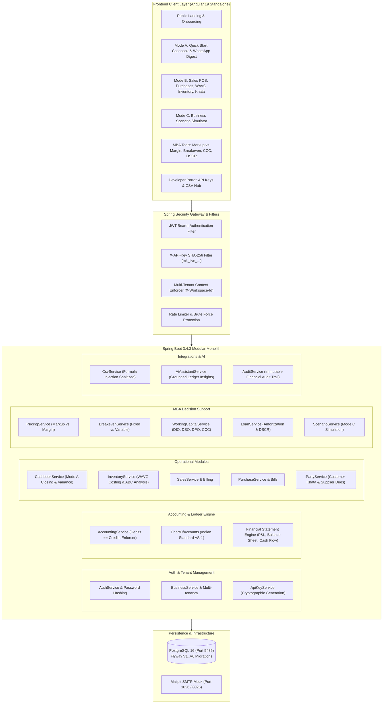

# MarginOS — System Architecture & Design Specification

## 1. Executive Summary

**MarginOS** is a financial operating system and decision-support platform engineered specifically for Indian small and medium enterprises (kirana stores, retail shops, electrical/hardware outlets, apparel retailers, distributors, and service businesses).

Unlike generic global accounting software, MarginOS addresses core Indian SME operational realities:
1. **Low Bookkeeping Maturity Barrier**: Businesses can start on Day 1 using **Mode A (Quick Start)** with simple 3-click daily sales/expense totals and closing cash counts without needing SKUs, customers, or bank feeds.
2. **Strict Double-Entry Backbone**: Regardless of whether entries are created via Quick Start, Sales POS, or Purchase bills, the backend enforces immutable, balanced double-entry accounting (`Debits == Credits`) using high-precision `BigDecimal` arithmetic.
3. **MBA Decision Support Engine**: Actively demystifies the "Kirana Markup Trap" (Markup vs. Margin), calculates unit break-even milestones, monitors the Working Capital Cash Conversion Cycle (CCC = DIO + DSO - DPO), and tests loan affordability using Debt Service Coverage Ratio (DSCR).
4. **Mode C Business Simulator**: Allows shopkeepers to model hypothetical expansions (e.g. opening a second branch, hiring staff, or taking a loan) in a sandboxed projection engine without altering live accounting books.

---

## 2. High-Level Architecture Diagram



---

## 3. Core Architectural Pillars

### 3.1 Strict Multi-Tenancy & Data Isolation
- Every core entity table in PostgreSQL contains a mandatory `business_id UUID NOT NULL` column indexed with foreign key constraints.
- Multi-tenancy is verified on every request at the service layer:
  ```java
  public Business getActiveBusinessForUser(UUID userId, UUID requestedBusinessId) {
      // Verifies active user membership in requested workspace
      return membershipRepository.findByUserIdAndBusinessId(userId, requestedBusinessId)
          .orElseThrow(() -> new AccessDeniedException("Unauthorized workspace access"));
  }
  ```
- Users cannot access or tamper with another business's financial data by manipulating URL path parameters or request payloads.

### 3.2 High-Precision Financial Calculations
- **Never use floating-point types (`float`, `double`) for money.** MarginOS strictly employs Java `BigDecimal` with `RoundingMode.HALF_UP` and database columns configured as `NUMERIC(19, 4)` or `NUMERIC(19, 2)`.
- Prevents roundoff discrepancies across large transaction volumes and multi-line invoices.

### 3.3 Zero-Drift Double-Entry Accounting
- Every financial mutation (Sales invoice, Quick cash sale, Purchase bill, Operating expense, Mode A daily closing) writes balanced journal entries:
  $$\sum \text{Debits} = \sum \text{Credits}$$
- Posted journal entries are strictly immutable. Corrections must be performed through formal compensating reversal entries (`AccountingService.reverseJournalEntry()`), preserving complete audit integrity.

### 3.4 Weighted-Average Costing (WAVG)
- Indian accounting standards (AS-2 / Ind-AS 2) require inventory to be valued at the lower of cost or net realizable value using FIFO or Weighted Average.
- When new purchase bills are posted:
  $$\text{New WAVG Cost} = \frac{(\text{Existing Qty} \times \text{Current WAVG}) + (\text{New Qty} \times \text{Purchase Price})}{\text{Existing Qty} + \text{New Qty}}$$
- When sales occur, inventory is deducted at the current WAVG cost, immediately recognizing Cost of Goods Sold (COGS).

---

## 4. Technology Stack

| Layer | Technology | Version | Purpose |
| :--- | :--- | :--- | :--- |
| **Backend Framework** | Spring Boot | 3.4.3 | High-throughput, production-grade modular monolith |
| **Language** | Java (OpenJDK) | 17 LTS | Enterprise stability, robust type safety |
| **Database** | PostgreSQL | 16 | Relational consistency, ACID transactions |
| **Database Migrations** | Flyway | 11.3.4 | Version-controlled, idempotent schema migrations (V1 to V6) |
| **Security** | Spring Security + JJWT | 0.12.6 | Stateless JWT authentication, role-based authorization |
| **API Documentation** | Springdoc OpenAPI | 2.8.5 | Swagger UI & OpenAPI 3.0 contract specification |
| **Frontend Framework** | Angular | 19.1.5 | Modern standalone component architecture, signals |
| **Styling** | Custom Design System | CSS3 / Tailwind | Responsive, mobile-first design with Indian Rupee formatting |
| **Containerization** | Docker Compose | v2 | Reproducible multi-service deployment |
