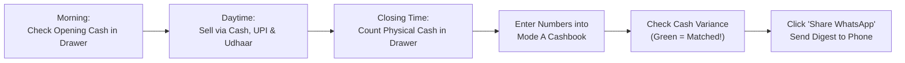

# MarginOS — Shopkeeper & Retailer User Guide

## Welcome to MarginOS

MarginOS is built for the Indian shopkeeper. You do not need to be an accountant, you do not need to connect your bank account, and you do not need to enter hundreds of products before seeing value.

---

## 1. Operating in Mode A (Quick Start)

### Why Mode A?
When you are busy dealing with customers, distributors, and delivery boys, you do not have time to enter every single biscuit packet or soap bar into a computer. 

Mode A lets you run your business with **one 2-minute check at the end of the day**.

### The Daily 3-Click Closing Routine

#### Step 1: Open the Cashbook (`/cashbook`)
1. Click **Daily Cashbook** in the navigation.
2. Confirm the **Opening Cash** (this carries forward from yesterday's closing).

#### Step 2: Enter Today's Totals
- **Cash Sales (₹)**: Total money taken in cash.
- **UPI / Digital Sales (₹)**: Total from PhonePe / GPay / Paytm QR standee.
- **Credit Sales (Udhaar Given) (₹)**: Goods given on trust today.
- **Customer Collections (₹)**: Old udhaar money collected back from customers today.
- **Cash Purchases (₹)**: Milk, bread, or emergency stock bought with drawer cash.
- **Daily Operating Expenses (₹)**: Helper wage, tea/snacks, electricity, polythene bags.

#### Step 3: Count Your Cash & Check Variance
1. Count the physical notes and coins in your cashbox.
2. Type the total into **Physical Cash Counted**.
3. MarginOS instantly calculates:
   - **Green Badge (✓ Matched)**: Drawer is 100% reconciled. No money is missing.
   - **Red Badge (⚠️ Shortage)**: Money is missing. You may have forgotten to write down an expense or given extra change to a customer.
   - **Yellow Badge (ℹ️ Surplus)**: Extra cash in drawer. A customer paid without you recording it.

#### Step 4: 1-Click WhatsApp Closing Digest
1. Click **Post Daily Closing**.
2. Click **Send WhatsApp**.
3. MarginOS formats a clean WhatsApp message and opens WhatsApp Web/Mobile. Send it to yourself, your partner, or your accountant!

---

## 2. Managing Customer Udhaar (Khata)

Customer credit is the lifeblood of Indian neighborhood stores, but uncollected udhaar destroys working capital.

1. Open **Customer Khata** (`/customers`).
2. View receivables broken down by age:
   - **0-30 Days**: Normal credit period.
   - **31-60 Days**: Time to send a polite reminder.
   - **61-90 Days**: Urgent follow up needed.
   - **90+ Days**: High risk of bad debt; freeze further credit.
3. Click the **💬 Remind via WhatsApp** button next to any customer. MarginOS creates a polite, pre-formatted payment reminder with your shop name and exact rupee balance.

---

## 3. Transitioning to Mode B (Detailed ERP)

When your business grows or you hire billing staff:
1. Switch to **Mode B** in the top navigation bar.
2. Use **Sales & POS Billing** (`/sales`) to create itemized GST bills with automatic inventory deductions.
3. Use **Purchases & Bills** (`/purchases`) to record supplier bills; MarginOS automatically calculates your Weighted-Average Cost (WAVG) so your profit margins are never distorted.
4. Export trial balances and P&L directly to Excel/CSV for your Chartered Accountant at GST filing time.
